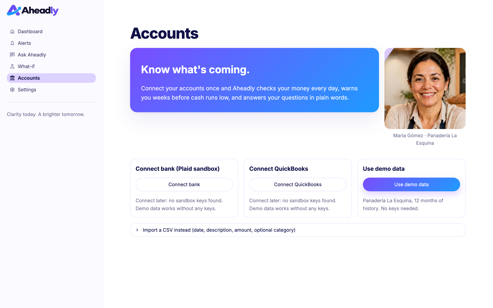
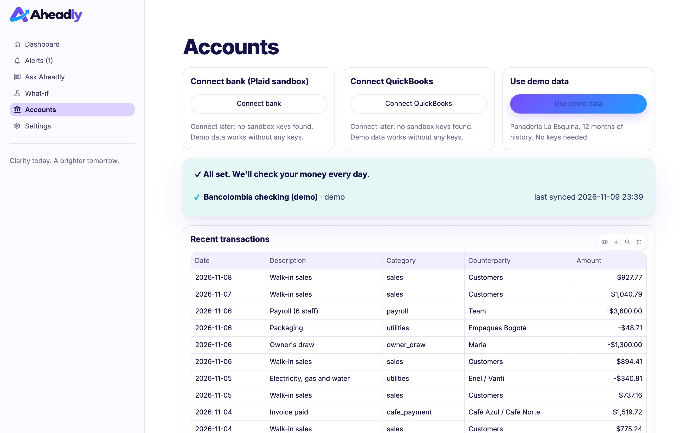
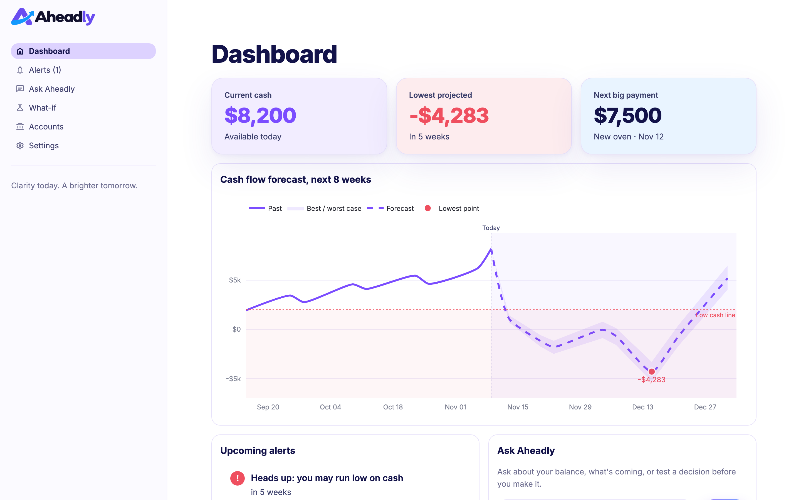
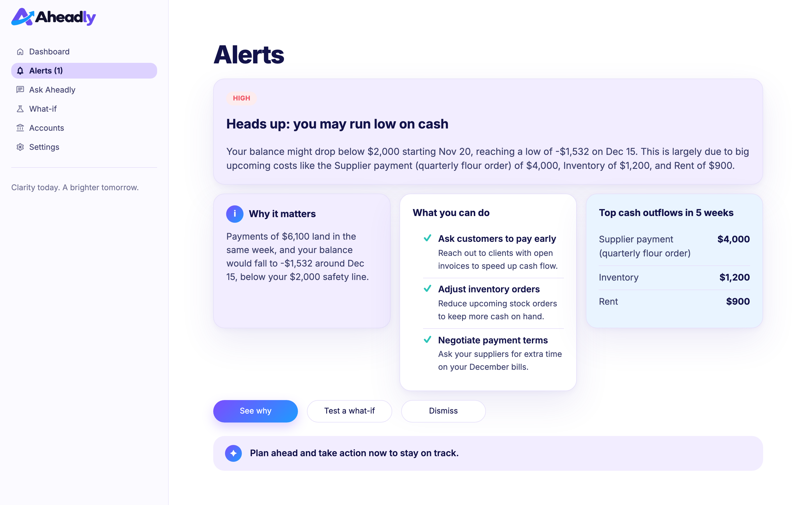
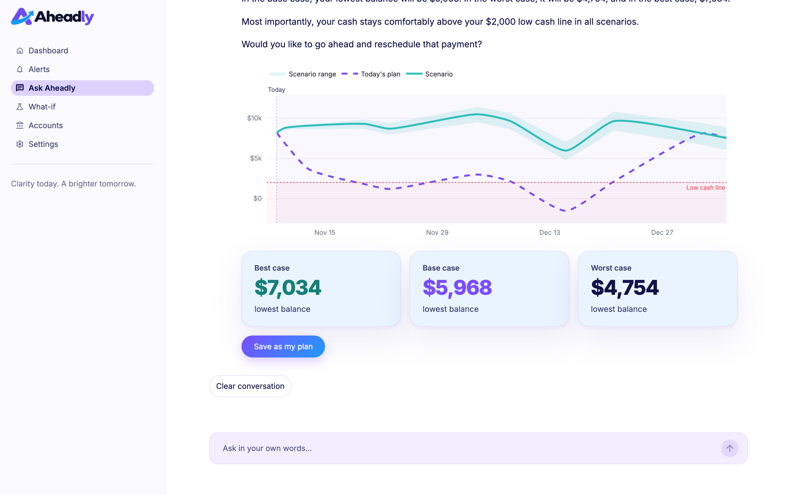
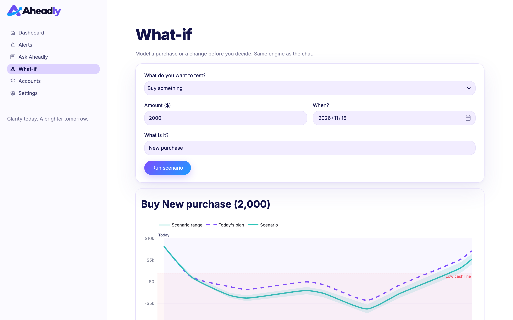
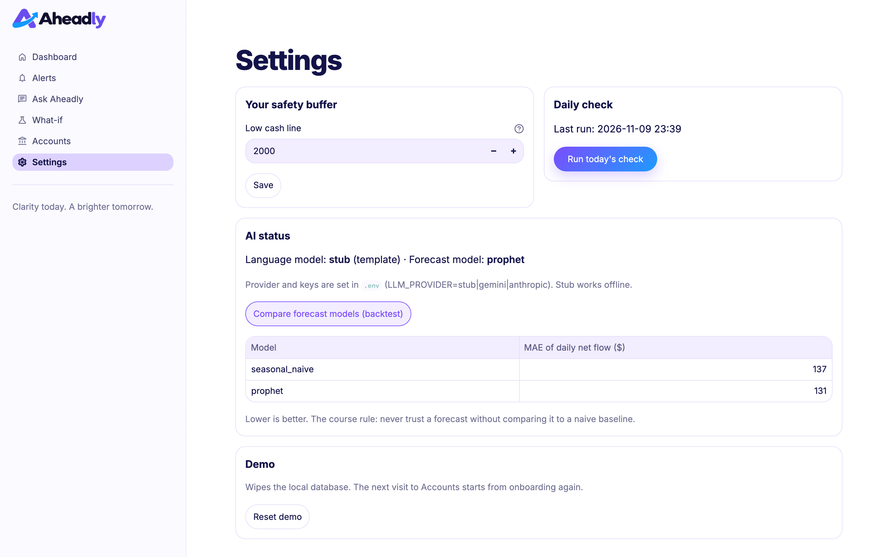
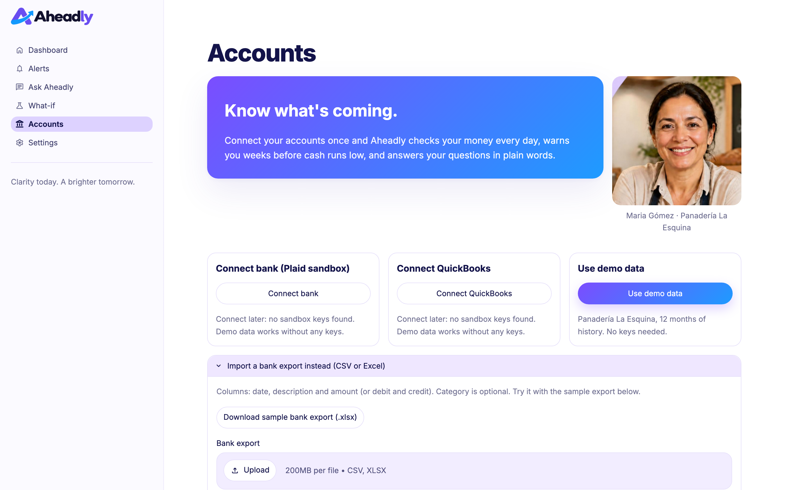

# Aheadly · Milestone 2 project check-in

Team: Laura Rodriguez, Fernando Siman, Mauricio Hasbun, Miguel Royo · AI-Driven App Development · November 2026

---

## 1. Project summary

**Problem.** Owners of small local businesses have the numbers but not the answers. They check today's bank balance and spreadsheets that describe the past, so payroll, supplier payments and big purchases are decided blind. Bills cluster in one week and the owner notices when the money is gone.

**Persona.** Maria Gómez, 45, owner of Panadería La Esquina in Bogotá. Six employees, two cafés she supplies on credit, QuickBooks set up by her accountant. *"I know how to bake. I just need to know if I'll have enough cash next month."*

**Solution.** Aheadly connects her bank and books once, forecasts her cash eight weeks ahead every day, warns her in plain words weeks before trouble, and lets her test a decision before making it.

**Four use cases (unchanged from Milestone 1).**

| # | Use case | Status today |
|---|---|---|
| 1 | Connect financial accounts | Demo data + CSV import work end to end; Plaid and QuickBooks sandbox are scaffolds |
| 2 | Receive early-warning alert | Working (shortfall + idle cash, deterministic rules, plain-language text) |
| 3 | Ask about my numbers | Working (chat with function calling over six tools, number guardrail) |
| 4 | Test a what-if scenario | Working in chat and in a form; scenario can be saved as the plan |

**Stack.** Python 3.11 managed with `uv`, Streamlit, SQLite (stdlib `sqlite3`), Prophet, Gemini (default) or Claude, pytest, black, GitHub Actions.

---

## 2. Codebase and architecture

### 2.1 Layers match the component diagram

```
┌──────────────────────── Application layer ────────────────────────┐
│  Streamlit UI   app.py · aheadly/ui/views/*.py · aheadly/ui/*      │
│        │ Get Insights  (AppCore.get_dashboard / get_alerts / ask / run_what_if / save_plan)
│  App Core       aheadly/core/app_core.py · alert_rules.py          │
└────────┬───────────────────────────────┬──────────────────────────┘
         │ Run Forecast                  │ Explain Results
┌────────▼────────── AI layer ───────────▼──────────────────────────┐
│  Forecast Engine                 Insight Translator                │
│  forecast_engine.py, models.py   insight_translator.py, prompts.py │
│  scenarios.py                    tools.py, guardrails.py           │
│                                  llm_client.py → Gemini / Claude / stub
└────────┬──────────────────────────────────────────────────────────┘
         │ Read/Write Data
┌────────▼────────── Data layer ────────────────────────────────────┐
│  Data Repository  repository.py + schema.sql (SQLite)              │
│        │ Sync Transactions                                         │
│  Connectors  demo · csv · plaid (scaffold) · quickbooks (scaffold) │
└───────────────────────────────────────────────────────────────────┘
```

Dependency rules enforced in code: page scripts import only `aheadly.ui.*` and call `AppCore`; `AppCore` never imports an LLM SDK; only `llm_client.py` imports `openai` / `anthropic`; only `repository.py` contains SQL.

### 2.2 Object-oriented design (lecture 7)

| Concept | Where |
|---|---|
| Encapsulation / abstraction | `AppCore().get_dashboard()` is all the UI knows; `Repository` hides every SQL statement; `ForecastEngine.forecast()` hides Prophet |
| Polymorphism | `StubClient`, `GeminiClient`, `AnthropicClient` share `chat(messages, tools)`; `SeasonalNaiveModel` and `ProphetModel` share `fit / predict / sample_paths`; every connector returns a `SyncPayload` |
| Dataclasses | `Business`, `Transaction`, `ScheduledItem`, `ForecastResult`, `Alert`, `Adjustment`, `ScenarioResult`, `ChatAnswer` in `domain.py` |
| No deep inheritance | Protocols (`ForecastModel`, `Connector`) instead of base classes |

### 2.3 The core flow in code (activity diagram)

`AppCore.run_daily_check()`:

1. `Repository.daily_net_flow()` → history without scheduled-type payments
2. `ForecastEngine.forecast()` → 56 daily points, p10 / p50 / p90, saved to `forecast_runs`
3. `alert_rules.detect_alerts()` → *risk or idle cash?* (deterministic, no LLM)
4. `InsightTranslator.write_alert(facts)` → plain-language title, body, 2–3 actions (guardrail-checked)
5. `Repository.add_alert()` or `update_alert()` (no duplicates within ±3 days); alerts whose risk disappeared are resolved

Triggered (a) by `python -m aheadly.jobs.daily_run`, (b) on app load when the last run is older than 24 h, (c) from Settings → *Run today's check*.

### 2.4 The AI, concretely

* **Forecast Engine.** Prophet (flat trend, weekly seasonality, Colombian holidays) fitted on residual daily net flow; 500 sampled paths; scheduled items (bills, payroll, rent, receivables, planned purchases) added deterministically; cumulated from today's balance; percentiles give worst / base / best. Paths are cached per history, so a what-if only swaps the scheduled items and is instant.
* **Backtest (lecture 18 rule).** Last 28 days held out, MAE of daily net flow: seasonal naive ≈ $138, Prophet ≈ $128. Available in Settings.
* **Function calling.** Six tools in `tools.py`; `ToolDispatcher` maps each to an `AppCore` method and returns JSON; errors come back as `{"error": ...}` so the chat never crashes.
* **Guardrail.** `guardrails.check_numbers()` extracts every number in the answer and checks it against the facts / tool outputs of that turn (format-insensitive, ±1 or 1.5%). Fail → one retry with a correction message → deterministic template from `templates.py`. Failures are logged and counted.
* **Prompt-injection stance.** Transaction descriptions and tool outputs are passed as data; the system prompt says so.

### 2.5 Production-ready habits (lectures 11, 16, 17)

* Fail fast: invalid `LLM_PROVIDER` or missing key → `st.error` + `st.stop()` before any cached call. Graceful fallback: LLM error or guardrail failure → template answer with a small note; Plaid/QuickBooks not configured → "Connect later", demo data offered.
* `@st.cache_resource` for `AppCore` (SQLite connection, LLM client, model); `st.session_state` for pending questions and scenario cards; `st.spinner` on sync / forecast / LLM.
* Secrets only in `.env` (`python-dotenv`), `.env.example` shipped, CI secret scan.
* 34 pytest tests (unit tests per component + the demo script as a functional test), all offline, run in under a second. `black` formatting. CI on push and PR.

---

## 3. Demo of current UI and functionality

Live demo order (DEMO_MODE, stub provider; repeat step 5 with Gemini if a key is available):

1. **Accounts** – welcome card, three connect options, *Use demo data* → "All set", transactions table.
2. **Dashboard** – Current cash $8,200 · Lowest projected ≈ −$4,000 in 5 weeks (red) · Next big payment · 8-week chart with best/worst band, red low cash line, lowest-point marker, "Today" line · Upcoming alerts · Ask box.
3. **Alerts** – badge "(1)"; medium/high severity pill; Why it matters · What you can do (3 actions) · Top cash outflows table; *See why* / *Test a what-if* / *Dismiss*.
4. **Ask Aheadly** – suggestion chips; "What if I buy the new oven next month instead?" → tool call `run_scenario` → answer + comparison chart + Best / Base / Worst card → *Save as my plan*.
5. **Dashboard again** – lowest projected turns green; alert resolved.
6. **What-if form** – "Change sales −10%" to show the same engine from a form; scenario history.
7. **Settings** – low cash line, AI status (provider + forecast model), *Compare forecast models* backtest table, *Run today's check*, *Reset demo*.

Success metric from the storyboard: from opening the alert to a saved decision in under two minutes.

---

## 4. Remaining tasks for the final demonstration

| Priority | Task | Owner | Notes |
|---|---|---|---|
| 1 | Plaid sandbox connector | | `plaid-python`; sandbox public token → access token → `/transactions/sync`; sign mapping already tested |
| 1 | QuickBooks sandbox connector | | Intuit OAuth 2.0; open Bills → scheduled bills, open Invoices → receivables |
| 1 | Run the demo script with Gemini and tune prompts | | Watch guardrail counter; keep stub as fallback |
| 2 | Deploy to Streamlit Community Cloud, keys in app secrets, smoke tests | | README already has the steps |
| 2 | Branch protection on `main`, teammate PR reviews, CI green | | Workflow file exists |
| 3 | Screenshots in `docs/`, final deck, 2-minute demo rehearsal | | |
| 3 | Stretch: Spanish copy (`copy.py` is ready for it), Hugging Face zero-shot transaction categoriser for CSV/QuickBooks rows, "High expense trend: Utilities" insight | | Record in `DECISIONS.md` if added |

Risks: Plaid Link is a JavaScript widget (we use the sandbox shortcut instead); Gemini free-tier rate limits during a live demo (stub fallback covers it); Prophet install time on Streamlit Cloud (naive model fallback exists behind the same interface).

---

## Appendix: screenshots (demo mode; Alerts and Ask Aheadly taken 2026-11-10 with Gemini `gemini-3.5-flash-lite`, the rest 2026-11-09 with the stub)

| | |
|---|---|
|  |  |
|  |  |
|  |  |
|  |  |
