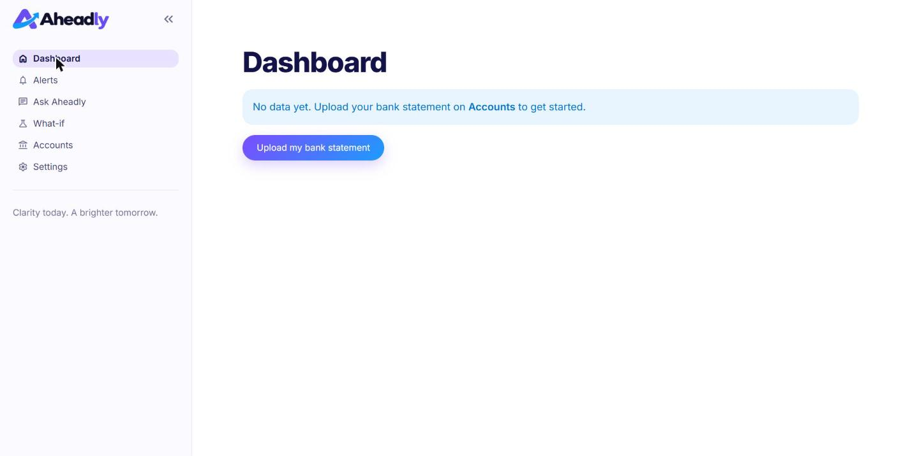

# Aheadly · Milestone 2 project check-in

Team: Laura Rodriguez, Fernando Siman, Mauricio Hasbun, Miguel Royo · AI-Driven App Development · November 2026

---

## 1. Project summary

**Problem.** Owners of small local businesses have the numbers but not the answers. They check today's bank balance and spreadsheets that describe the past, so payroll, supplier payments and big purchases are decided blind. Bills cluster in one week and the owner notices when the money is gone.

**Persona.** Maria Gómez, 45, owner of Panadería La Esquina in Bogotá. Six employees, two cafés she supplies on credit. Her bank gives her a statement; she keeps her upcoming orders and big bills in her own Excel. *"I know how to bake. I just need to know if I'll have enough cash next month."*

**Solution.** Maria uploads her bank statement (and, if she likes, her list of upcoming payments) once. Aheadly forecasts her cash eight weeks ahead, warns her in plain words weeks before trouble, and lets her test a decision before making it.

**Four use cases (unchanged from Milestone 1).**

| # | Use case | Status today |
|---|---|---|
| 1 | Connect financial accounts | Bank statement upload (CSV or Excel) plus an optional upcoming-payments file work end to end; Plaid and QuickBooks remain scaffolds for later |
| 2 | Receive early-warning alert | Working (shortfall + idle cash, deterministic rules, plain-language text) |
| 3 | Ask about my numbers | Working (chat with function calling over six tools, number guardrail) |
| 4 | Test a what-if scenario | Working in chat and in a form; scenario can be saved as the plan |

**Stack.** Python 3.11 managed with `uv`, Streamlit, SQLite (stdlib `sqlite3`), Prophet, Gemini (default) or Claude, pytest, black, GitHub Actions.

---

## 2. Codebase and architecture

### 2.1 Layers match the component diagram

```
┌──────────────────────── Application layer ────────────────────────┐
│  Streamlit UI   app.py · aheadly/ui/views/*.py · aheadly/ui/*      │
│        │ Get Insights  (AppCore.get_dashboard / get_alerts / ask / run_what_if / save_plan)
│  App Core       aheadly/core/app_core.py · alert_rules.py          │
└────────┬───────────────────────────────┬──────────────────────────┘
         │ Run Forecast                  │ Explain Results
┌────────▼────────── AI layer ───────────▼──────────────────────────┐
│  Forecast Engine                 Insight Translator                │
│  forecast_engine.py, models.py   insight_translator.py, prompts.py │
│  scenarios.py                    tools.py, guardrails.py           │
│                                  llm_client.py → Gemini / Claude / stub
└────────┬──────────────────────────────────────────────────────────┘
         │ Read/Write Data
┌────────▼────────── Data layer ────────────────────────────────────┐
│  Data Repository  repository.py + schema.sql (SQLite)              │
│        │ Sync Transactions                                         │
│  Connectors  csv/excel upload · demo (tests) · plaid, qbo (later) │
└───────────────────────────────────────────────────────────────────┘
```

Dependency rules enforced in code: page scripts import only `aheadly.ui.*` and call `AppCore`; `AppCore` never imports an LLM SDK; only `llm_client.py` imports `openai` / `anthropic`; only `repository.py` contains SQL.

### 2.2 Object-oriented design (lecture 7)

| Concept | Where |
|---|---|
| Encapsulation / abstraction | `AppCore().get_dashboard()` is all the UI knows; `Repository` hides every SQL statement; `ForecastEngine.forecast()` hides Prophet |
| Polymorphism | `StubClient`, `GeminiClient`, `AnthropicClient` share `chat(messages, tools)`; `SeasonalNaiveModel` and `ProphetModel` share `fit / predict / sample_paths`; every connector returns a `SyncPayload` |
| Dataclasses | `Business`, `Transaction`, `ScheduledItem`, `ForecastResult`, `Alert`, `Adjustment`, `ScenarioResult`, `ChatAnswer` in `domain.py` |
| No deep inheritance | Protocols (`ForecastModel`, `Connector`) instead of base classes |

### 2.3 The core flow in code (activity diagram)

`AppCore.run_daily_check()`:

1. `Repository.daily_net_flow()` → history without scheduled-type payments
2. `ForecastEngine.forecast()` → 56 daily points, p10 / p50 / p90, saved to `forecast_runs`
3. `alert_rules.detect_alerts()` → *risk or idle cash?* (deterministic, no LLM)
4. `InsightTranslator.write_alert(facts)` → plain-language title, body, 2–3 actions (guardrail-checked)
5. `Repository.add_alert()` or `update_alert()` (no duplicates within ±3 days); alerts whose risk disappeared are resolved

Triggered (a) by `python -m aheadly.jobs.daily_run`, (b) on app load when the last run is older than 24 h, (c) from Settings → *Run today's check*.

### 2.4 The AI, concretely

* **Forecast Engine.** Prophet (flat trend, weekly seasonality, Colombian holidays) fitted on residual daily net flow; 500 sampled paths; scheduled items (bills, payroll, rent, receivables, planned purchases) added deterministically; cumulated from today's balance; percentiles give worst / base / best. Paths are cached per history, so a what-if only swaps the scheduled items and is instant.
* **Backtest (lecture 18 rule).** Last 28 days held out, MAE of daily net flow: seasonal naive ≈ $138, Prophet ≈ $128. Available in Settings.
* **Function calling.** Six tools in `tools.py`; `ToolDispatcher` maps each to an `AppCore` method and returns JSON; errors come back as `{"error": ...}` so the chat never crashes.
* **Guardrail.** `guardrails.check_numbers()` extracts every number in the answer and checks it against the facts / tool outputs of that turn (format-insensitive, ±1 or 1.5%). Fail → one retry with a correction message → deterministic template from `templates.py`. Failures are logged and counted.
* **Prompt-injection stance.** Transaction descriptions and tool outputs are passed as data; the system prompt says so.

### 2.5 Production-ready habits (lectures 11, 16, 17)

* Fail fast: invalid `LLM_PROVIDER` or missing key → `st.error` + `st.stop()` before any cached call. Graceful fallback: LLM error or guardrail failure → template answer with a small note; a file that can't be read → a friendly error, nothing is saved, the owner can try again.
* `@st.cache_resource` for the shared forecast model and LLM client; one `AppCore` with its own in-memory SQLite database per visitor in `st.session_state` (every visit starts fresh, nobody sees anyone else's data); `st.session_state` also holds pending questions and scenario cards; `st.spinner` on sync / forecast / LLM.
* Secrets only in `.env` (`python-dotenv`), `.env.example` shipped, CI secret scan.
* 69 pytest tests (unit tests per component, plus the demo script and the upload flow as functional tests), all offline, run in a few seconds. `black` formatting. CI on push and PR.

---

## 3. Demo of current UI and functionality

Live demo order (stub provider; repeat step 4 with Gemini if a key is available). Maria's two files are created outside the app on the day of the demo, so her statement ends yesterday.

1. **Accounts** – a fresh, empty app: every visitor starts from zero. Upload card: business name, Maria's bank statement (12 months of bank-style lines such as `ABONO VENTAS DATAFONO REDEBAN`, `PAGO NOMINA 6 EMPLEADOS`, `PAGO ARRIENDO LOCAL`) and her upcoming one-off payments (new oven, quarterly flour order, inventory restock, two café Christmas orders) → *Upload and analyse* → "All set"; the current balance ($8,200) is read from the statement.
2. **Dashboard** – Current cash $8,200 · Lowest projected ≈ −$3,500 in 5 weeks (red) · Next big payment: new oven · 8-week chart with best/worst band, red low cash line, lowest-point marker, "Today" line · Upcoming alerts · Ask box.
3. **Alerts** – badge "(1)"; severity pill; the cause in plain words (quarterly flour order $4,000 and inventory restock $1,200 land in the same week, right after the $7,500 oven); Why it matters · What you can do (3 actions) · Top cash outflows; *See why* / *Test a what-if* / *Dismiss*.
4. **Ask Aheadly** – "What if I buy the new oven next month instead?" → tool call `run_scenario` → answer + comparison chart + Best / Base / Worst card ("That looks safe: even in a bad month you stay above your low cash line") → *Save as my plan*.
5. **Dashboard again** – lowest projected turns green; alert resolved.
6. **What-if form** – a purchase that keeps the base case above the line but pushes the worst case below it shows the third risk level: "keep an eye on it" (never "safe").
7. **Settings** – low cash line, AI status (provider + forecast model), *Compare forecast models* backtest table, *Run today's check*, *Start over*.

Success metric from the storyboard: from opening the alert to a saved decision in under two minutes.

---

## 4. Remaining tasks for the final demonstration

**Direction (agreed 2026-11-10).** The final version targets a small business that only has bank statements (Excel/CSV), plus maybe its own Excel files. No QuickBooks or live bank connection yet; the Plaid and QuickBooks scaffolds stay for later. The app learns the business by detecting patterns in the statement and asking the owner short questions. It works as a one-time session (each visit starts fresh), with a way to save and reload a setup.

**Done since the first draft of this check-in (2026-11-10).** Every visitor starts with an empty app (no shared data); upload-only onboarding (bank statement + optional upcoming payments, balance read from the file, no demo or Plaid/QuickBooks buttons, no bakery defaults); honest verdicts with three risk levels (act now / keep an eye on it / safe) using the worst case; "next month" questions answered for next month; wording that works for any business. On 2026-11-11: Latin American bank formats (day/month dates, "1.250,00" amounts, unreadable rows reported instead of becoming $0), a "What we're counting on" list on Accounts, and suggested questions that name the business's own biggest upcoming payment. 69 tests.

| Priority | Task | Notes |
|---|---|---|
| 1 | Finish reading real bank files | Day/month dates and "1.250,00" amounts are done; still to do: forecast from the statement's last date, check that the balance adds up |
| 1 | Test businesses with answer keys + automated tests | Fake statements for several different businesses, made separately from the code |
| 1 | Categories and recurring payments from bank statements | Rules + Hugging Face zero-shot categoriser; recurring detection without double counting |
| 1 | Money plan page + onboarding questions | One editable list of everything the forecast expects; "detect first, then ask" |
| 2 | Actions with "Test this" + suggested fixes | Every warning comes with concrete actions the app has already tested |
| 2 | Financing helper | Compares the owner's existing options (credit line, card, supplier terms) by cost; never offers credit |
| 2 | Insights page | "Things we noticed" patterns, with a short summary under every chart |
| 3 | Download / Load my data, privacy page, glossary, chatbot test set | |
| 3 | Final demo with the test businesses, deck, rehearsal | |

Risks: Gemini free-tier rate limits during a live demo (the offline fallback covers it); Prophet install time on Streamlit Cloud (naive model fallback behind the same interface); real bank files are messy (the test businesses are how we catch it).

---

## Appendix: screenshots (Maria's upload-only flow, 2026-11-11)

| | |
|---|---|
|  |  |
|  |  |
|  |  |
|  |  |
